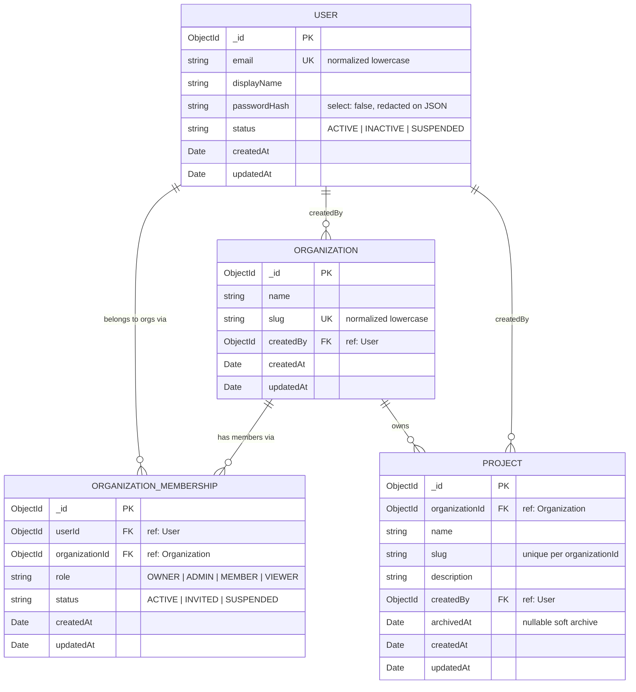

# `@vibeshield/database`

Shared MongoDB connectivity, connection lifecycle management, and core Mongoose domain models for VibeShield Node.js services.

## Responsibilities

### 1. Connection Lifecycle Management
- Establish and manage MongoDB connections via Mongoose (`connectDatabase`, `DatabaseConnectionManager`).
- Expose normalized connection state and readiness status (`getDatabaseState`, `isDatabaseConnected`, `getDatabaseStatus`).
- Deduplicate concurrent or repeated connection and disconnection calls.
- Support graceful shutdown without hanging processes.
- Validate MongoDB connection URI syntax (`isValidMongoUri`).
- Redact MongoDB URIs and credentials from logs and error messages (`redactMongoUri`, `formatSafeError`).

### 2. Core Multi-Tenant Domain Models
- **`UserModel`** (`users` collection): Platform user identity, normalized email, credential hash storage (`select: false` + serialization redaction), and account status (`ACTIVE`, `INACTIVE`, `SUSPENDED`).
- **`OrganizationModel`** (`organizations` collection): Top-level tenant boundary with globally unique normalized slug and creator reference.
- **`OrganizationMembershipModel`** (`organization_memberships` collection): Explicit many-to-many join model linking users to organizations with controlled roles (`OWNER`, `ADMIN`, `MEMBER`, `VIEWER`) and membership status (`ACTIVE`, `INVITED`, `SUSPENDED`).
- **`ProjectModel`** (`projects` collection): Tenant-owned project record scoped to an `Organization`, with organization-scoped unique slug, creator reference, and non-destructive `archivedAt` timestamp.

> [!NOTE]
> Importing `@vibeshield/database` or its models never automatically initiates a database connection. Connections are established only when the host application explicitly invokes `connectDatabase()` or `manager.connect()`.

## Non-Responsibilities

This package deliberately excludes:
- Authentication, password hashing, or JWT issuance logic.
- Express or HTTP framework dependencies and authorization middleware.
- Application environment loading (callers pass the connection URI explicitly).
- Premature repository, scan execution, or vulnerability finding models.

## Data Model Relationships



## Indexes and Uniqueness Constraints

| Model | Index Keys | Unique | Index Name | Purpose |
| --- | --- | --- | --- | --- |
| `User` | `{ email: 1 }` | Yes | `users_email_unique` | Enforce unique normalized email & fast account lookup |
| `User` | `{ status: 1 }` | No | `users_status_idx` | Operational queries by user status |
| `Organization` | `{ slug: 1 }` | Yes | `organizations_slug_unique` | Global tenant slug uniqueness & routing lookup |
| `Organization` | `{ createdBy: 1 }` | No | `organizations_created_by_idx` | Lookup organizations created by a user |
| `OrganizationMembership` | `{ organizationId: 1, userId: 1 }` | Yes | `org_memberships_org_user_unique` | Prevent duplicate memberships & check user access in org |
| `OrganizationMembership` | `{ userId: 1, status: 1 }` | No | `org_memberships_user_status_idx` | List active organizations for a user |
| `OrganizationMembership` | `{ organizationId: 1, role: 1, status: 1 }` | No | `org_memberships_org_role_status_idx` | Query active roles (e.g., active `OWNER` count) in an org |
| `Project` | `{ organizationId: 1, slug: 1 }` | Yes | `projects_org_slug_unique` | Organization-scoped project slug uniqueness & lookup |
| `Project` | `{ organizationId: 1, archivedAt: 1, createdAt: -1 }` | No | `projects_org_archived_created_idx` | Paginated listing of active/archived projects per org |
| `Project` | `{ createdBy: 1 }` | No | `projects_created_by_idx` | Audit lookup of projects by creator |

## Multi-Tenancy & Service-Layer Guidance

- **Tenant isolation**: Every `Project` strictly requires `organizationId`. API services must always scope project queries and mutations by `organizationId` after verifying an `ACTIVE` `OrganizationMembership` for the authenticated `userId`.
- **Multi-org users**: Membership lives in `OrganizationMembershipModel` rather than embedding org lists on `User` or member arrays on `Organization`, allowing users to hold distinct roles across any number of organizations.
- **Ownership consistency**: `Organization.createdBy` records immutable creation provenance, while active ownership and role permissions come from `OrganizationMembershipModel`. Future service operations creating an organization should create the `Organization` and initial `OWNER` `OrganizationMembership` inside a MongoDB transaction, and prevent demoting or deleting the last `ACTIVE` `OWNER` of an organization.
- **No model recompilation errors**: Models are registered via `getOrCreateModel()` to safely handle repeated imports or watch-mode reloads.

## Usage

```ts
import {
  connectDatabase,
  disconnectDatabase,
  UserModel,
  OrganizationModel,
  OrganizationMembershipModel,
  OrganizationRoleValue,
  ProjectModel,
} from '@vibeshield/database';

await connectDatabase(process.env.MONGODB_URI!);
// Use UserModel, OrganizationModel, OrganizationMembershipModel, ProjectModel
await disconnectDatabase();
```

## Known Limitations

- Schema-level unit tests verify Mongoose schema definitions, validators, normalizers, serialization transforms, and index metadata in memory without a running MongoDB server.
- Actual unique index creation (`E11000` duplicate key enforcement), multi-document transactions, and query plan execution require a live MongoDB replica set instance.
- `ProjectModel` currently omits repository integration fields (`repositoryUrl`, `defaultBranch`) intentionally; future repository integration tasks will extend `ProjectSchema` without breaking existing tenant isolation.

## Running Tests & Checks

```bash
pnpm --filter @vibeshield/database test
pnpm --filter @vibeshield/database typecheck
pnpm --filter @vibeshield/database build
```
