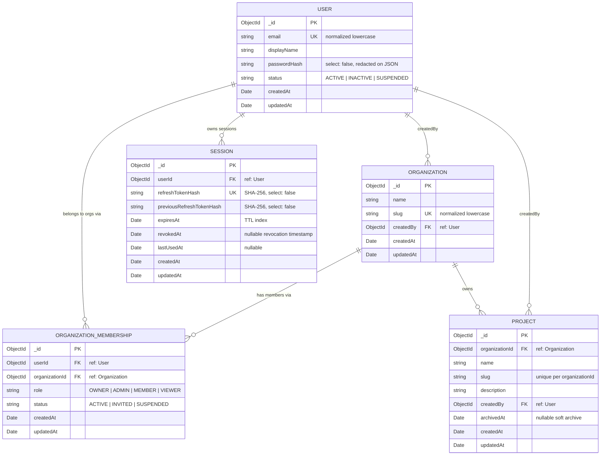

# `@vibeshield/database`

Shared MongoDB connectivity, connection lifecycle management, and core Mongoose domain models for VibeShield Node.js services.

## Responsibilities

### 1. Connection Lifecycle Management
- Establish and manage MongoDB connections via Mongoose (`connectDatabase`, `DatabaseConnectionManager`).
- Expose normalized connection state and readiness status (`getDatabaseState`, `isDatabaseConnected`, `getDatabaseStatus`).
- Deduplicate concurrent or repeated connection and disconnection calls.
- Support graceful shutdown without hanging processes.
- Validate MongoDB connection URI syntax (`isValidMongoUri`).
- Redact MongoDB URIs and GitHub credentials (`ghp_`/`ghs_`/etc., Bearer headers, PEM private keys, configured secret strings) from logs and error messages (`redactMongoUri`, `redactGitHubSecrets`, `formatSafeError`, `sanitizeAuditMetadata`).

### 2. Core Multi-Tenant Domain Models
- **`UserModel`** (`users` collection): Platform user identity, normalized email, credential hash storage (`select: false` + serialization redaction), and account status (`ACTIVE`, `INACTIVE`, `SUSPENDED`).
- **`OrganizationModel`** (`organizations` collection): Top-level tenant boundary with globally unique normalized slug and creator reference.
- **`OrganizationMembershipModel`** (`organization_memberships` collection): Explicit many-to-many join model linking users to organizations with controlled roles (`OWNER`, `ADMIN`, `MEMBER`, `VIEWER`) and membership status (`ACTIVE`, `INVITED`, `SUSPENDED`).
- **`ProjectModel`** (`projects` collection): Tenant-owned project record scoped to an `Organization`, with organization-scoped unique slug, creator reference, and non-destructive `archivedAt` timestamp. Repository integration metadata lives separately in `ProjectRepositoryConnectionModel`.
- **`SessionModel`** (`sessions` collection): Refresh-token session store tracking `userId`, SHA-256 `refreshTokenHash` (`select: false`), `previousRefreshTokenHash` (`select: false`) for atomic `N-1` rotation reuse detection, `expiresAt` (with TTL index), `revokedAt`, and `lastUsedAt`.
- **`RotatedRefreshTokenModel`** (`rotated_refresh_tokens` collection): Bounded TTL-indexed token-family store recording older rotated `tokenHash` values per `sessionId` so replays from `N-2` or earlier revoke the session without unbounded growth on `Session` documents.

### 3. GitHub Integration Models
- **`GitHubInstallationModel`** (`github_installations` collection): Links a GitHub App installation (`githubInstallationId`) to a single VibeShield `Organization` while active (`isActive: true` for `ACTIVE` or `SUSPENDED`; `false` for `REVOKED` or `DISCONNECTED`). Never persists access tokens or private keys.
- **`GitHubOAuthStateModel`** (`github_oauth_states` collection): Single-use authorization `stateHash` (SHA-256 hex, `select: false`, stripped on serialization) bound to `(userId, organizationId)` with a MongoDB TTL index on `expiresAt`.
- **`ProjectRepositoryConnectionModel`** (`project_repository_connections` collection): Links a `Project` to a GitHub repository (including `fullName`, `htmlUrl`, `defaultBranch`, `isPrivate`, and `isArchivedOnGitHub`) under an organization's `GitHubInstallation`. Separates `repositoryAccessState` (`CONNECTED | ACCESS_REVOKED | REPO_DELETED | DISCONNECTED`) from `installationAvailability` (`ACTIVE | SUSPENDED | REVOKED | DISCONNECTED`) so installation suspend/unsuspend cycles cannot restore independently revoked or deleted repositories. Uses explicit `isActive` boolean (`partialFilterExpression: { isActive: true }`) so disconnected historical records never block future reconnection.
- **`WebhookDeliveryModel`** (`webhook_deliveries` collection): Tracks GitHub `deliveryId` (unique index), `event`, `action`, `githubInstallationId`, `payloadSha256`, lifecycle `outcome` (`PROCESSING | PROCESSED | IGNORED | FAILED`), `outcomeReason`, `attemptCount`, durable bounded per-organization retry progress (`targetOrganizationIds`, `completedOrganizationIds`, `processedConnectionCount`, up to 1000 organizations), redacted `errorCode`/`errorMessage`, processing/completion/failure timestamps, and `expiresAt` TTL index for atomic webhook idempotency, concurrency safety, and partial-failure retries.
- **`IntegrationAuditLogModel`** (`integration_audit_logs` collection): Append-only audit log for installation and repository lifecycle actions, enforcing bounded sanitized `metadata` (stripping tokens, secrets, authorization headers, and PEM blocks) and blocking query-level updates.

> [!NOTE]
> Importing `@vibeshield/database` or its models never automatically initiates a database connection. Connections are established only when the host application explicitly invokes `connectDatabase()` or `manager.connect()`.

## Non-Responsibilities

This package deliberately excludes:
- Authentication, password hashing, or JWT issuance logic.
- Express or HTTP framework dependencies and authorization middleware.
- Application environment loading (callers pass the connection URI explicitly).
- GitHub HTTP clients, OAuth callback handlers, webhook endpoints, scanning workers, or vulnerability finding models (deferred to upcoming tasks).

## Data Model Relationships



## Indexes and Uniqueness Constraints

| Model | Index Keys | Unique | Index Name | Purpose |
| --- | --- | --- | --- | --- |
| `User` | `{ email: 1 }` | Yes | `users_email_unique` | Enforce unique normalized email & fast account lookup |
| `User` | `{ status: 1 }` | No | `users_status_idx` | Operational queries by user status |
| `Organization` | `{ slug: 1 }` | Yes | `organizations_slug_unique` | Global tenant slug uniqueness & routing lookup |
| `Organization` | `{ createdBy: 1 }` | No | `organizations_created_by_idx` | Lookup organizations created by a user |
| `OrganizationMembership` | `{ organizationId: 1, userId: 1 }` | Yes | `org_memberships_org_user_unique` | Prevent duplicate memberships & check user access in org |
| `OrganizationMembership` | `{ userId: 1, status: 1 }` | No | `org_memberships_user_status_idx` | List active organizations for a user |
| `OrganizationMembership` | `{ organizationId: 1, role: 1, status: 1 }` | No | `org_memberships_org_role_status_idx` | Query active roles (e.g., active `OWNER` count) in an org |
| `Project` | `{ organizationId: 1, slug: 1 }` | Yes | `projects_org_slug_unique` | Organization-scoped project slug uniqueness & lookup |
| `Project` | `{ organizationId: 1, archivedAt: 1, createdAt: -1 }` | No | `projects_org_archived_created_idx` | Paginated listing of active/archived projects per org |
| `Project` | `{ createdBy: 1 }` | No | `projects_created_by_idx` | Audit lookup of projects by creator |
| `Session` | `{ refreshTokenHash: 1 }` | Yes | `sessions_refresh_token_hash_unique` | Unique hashed refresh token lookup |
| `Session` | `{ previousRefreshTokenHash: 1 }` | No (Partial) | `sessions_prev_refresh_token_hash_idx` | Detect reuse of rotated refresh tokens |
| `Session` | `{ userId: 1, revokedAt: 1, expiresAt: 1 }` | No | `sessions_user_active_idx` | Query active sessions for a user |
| `Session` | `{ expiresAt: 1 }` | No (TTL `0s`) | `sessions_expires_at_ttl_idx` | Background cleanup of expired session documents |
| `RotatedRefreshToken` | `{ tokenHash: 1 }` | Yes | `rotated_tokens_hash_unique` | Unique lookup of previously rotated refresh token hashes |
| `RotatedRefreshToken` | `{ sessionId: 1 }` | No | `rotated_tokens_session_idx` | Link rotated token hashes back to parent session |
| `RotatedRefreshToken` | `{ expiresAt: 1 }` | No (TTL `0s`) | `rotated_tokens_expires_at_ttl_idx` | Automatic TTL cleanup bounding token-family storage |
| `GitHubInstallation` | `{ githubInstallationId: 1 }` | Yes (Partial `{ isActive: true }`) | `github_installations_active_id_unique` | Prevent an active installation ID from linking to multiple VibeShield orgs |
| `GitHubInstallation` | `{ organizationId: 1, isActive: 1, status: 1 }` | No | `github_installations_org_active_status_idx` | Org-scoped installation queries |
| `GitHubOAuthState` | `{ stateHash: 1 }` | Yes | `github_oauth_states_hash_unique` | Single-use OAuth state lookup |
| `GitHubOAuthState` | `{ expiresAt: 1 }` | No (TTL `0s`) | `github_oauth_states_expires_at_ttl_idx` | Automatic cleanup of expired OAuth states |
| `ProjectRepositoryConnection` | `{ projectId: 1 }` | Yes (Partial `{ isActive: true }`) | `proj_repo_conn_active_project_unique` | Enforce at most one active repository per project |
| `ProjectRepositoryConnection` | `{ organizationId: 1, githubRepositoryId: 1 }` | Yes (Partial `{ isActive: true }`) | `proj_repo_conn_active_org_repo_unique` | Prevent duplicate active connections for one repo in the same org |
| `ProjectRepositoryConnection` | `{ githubInstallationId: 1, githubRepositoryId: 1, isActive: 1 }` | No | `proj_repo_conn_webhook_lookup_idx` | Efficient webhook routing by installation & repo ID |
| `ProjectRepositoryConnection` | `{ organizationId: 1, projectId: 1, isActive: 1 }` | No | `proj_repo_conn_org_project_active_idx` | Efficient tenant-scoped project repository queries |
| `WebhookDelivery` | `{ deliveryId: 1 }` | Yes | `webhook_deliveries_delivery_id_unique` | Atomic webhook replay protection & idempotency |
| `WebhookDelivery` | `{ expiresAt: 1 }` | No (TTL `0s`) | `webhook_deliveries_expires_at_ttl_idx` | Bounded retention of delivery IDs |
| `IntegrationAuditLog` | `{ organizationId: 1, createdAt: -1 }` | No | `integration_audit_logs_org_created_idx` | Organization audit log timeline queries |
| `IntegrationAuditLog` | `{ organizationId: 1, projectId: 1, createdAt: -1 }` | No | `integration_audit_logs_org_project_created_idx` | Project-filtered audit log timeline queries |

## Multi-Tenancy & Service-Layer Guidance

- **Tenant isolation**: Every `Project` strictly requires `organizationId`. API services must always scope project queries and mutations by `organizationId` after verifying an `ACTIVE` `OrganizationMembership` for the authenticated `userId`.
- **Creator membership boundary**: Storing `organizationId` and `createdBy` on `Project` does **not** prove at the schema level that the creator belongs to that organization. Service-layer handlers must verify active `OrganizationMembership` in `organizationId` before creating or modifying a project.
- **Multi-org users**: Membership lives in `OrganizationMembershipModel` rather than embedding org lists on `User` or member arrays on `Organization`, allowing users to hold distinct roles across any number of organizations.
- **Ownership consistency**: `Organization.createdBy` is creator provenance, not a substitute for an active `OWNER` membership. Future service operations must create the `Organization` and its initial `OWNER` `OrganizationMembership` together (preferably inside a MongoDB transaction) and prevent removing or demoting the last `ACTIVE` `OWNER` of an organization.
- **Update & `.lean()` precautions**: Mongoose runs schema setters (`normalizeEmail`, `normalizeSlug`, `trim`, `lowercase`) during standard update casting, but update queries (`updateOne`, `findOneAndUpdate`, `updateMany`) do **not** run schema validators by default unless `{ runValidators: true }` is passed. Likewise, `.lean()` queries bypass Mongoose `toJSON`/`toObject` transforms—never serialize `.lean()` documents that explicitly selected `+passwordHash`.
- **Transaction support & per-organization mutation lock**: `runInTransaction(work)` executes multi-document operations inside `session.withTransaction()` and always closes the session. MongoDB transactions require a **replica set or sharded cluster** and never silently fall back to non-transactional writes. Under WiredTiger Snapshot Isolation, disjoint writes to `OrganizationMembership` or `Project` documents do not automatically conflict; services mutating organization membership, ownership, deletion, or `Project` documents call `acquireOrganizationMutationLock(organizationId, session)` (`$inc: { membershipVersion: 1 }` on `OrganizationModel`) first inside the transaction to serialize per-organization writes cleanly.
- **No model recompilation errors**: Models are registered via `getOrCreateModel()` to safely handle repeated imports or watch-mode reloads.

## Usage

```ts
import {
  connectDatabase,
  disconnectDatabase,
  UserModel,
  OrganizationModel,
  OrganizationMembershipModel,
  OrganizationRoleValue,
  ProjectModel,
} from '@vibeshield/database';

await connectDatabase(process.env.MONGODB_URI!);
// Use UserModel, OrganizationModel, OrganizationMembershipModel, ProjectModel
await disconnectDatabase();
```

## Known Limitations

- `pnpm --filter @vibeshield/database test` runs schema-level, redaction, and mocked connection unit tests in memory (`models.test.ts`, `github-models.test.ts`, `session.test.ts`, `connection.test.ts`) without a running MongoDB server.
- Real MongoDB transaction behavior (rollback, standalone failure without fallback, WiredTiger write conflicts, `E11000` unique/partial index enforcement, and TTL expiration) is verified separately via `pnpm run test:integration` using [transaction.integration.test.ts](file:///home/krishna/Coding/Projects/Vibeshield/packages/database/src/__tests__/transaction.integration.test.ts), [github-models.integration.test.ts](file:///home/krishna/Coding/Projects/Vibeshield/packages/database/src/__tests__/github-models.integration.test.ts), [organizations.integration.test.ts](file:///home/krishna/Coding/Projects/Vibeshield/apps/api/src/__tests__/organizations.integration.test.ts), and [projects.integration.test.ts](file:///home/krishna/Coding/Projects/Vibeshield/apps/api/src/__tests__/projects.integration.test.ts) against ephemeral replica-set and standalone MongoDB containers.
- Repository connection metadata lives separately in `ProjectRepositoryConnectionModel` (`ProjectModel` intentionally remains focused on core project metadata), and GitHub API client/routes/webhooks are not implemented yet.

## Running Tests & Checks

```bash
pnpm --filter @vibeshield/database test
pnpm --filter @vibeshield/database typecheck
pnpm --filter @vibeshield/database build
# From repository root (requires Docker or MONGODB_INTEGRATION_URI + MONGODB_STANDALONE_URI):
pnpm run test:integration
```
